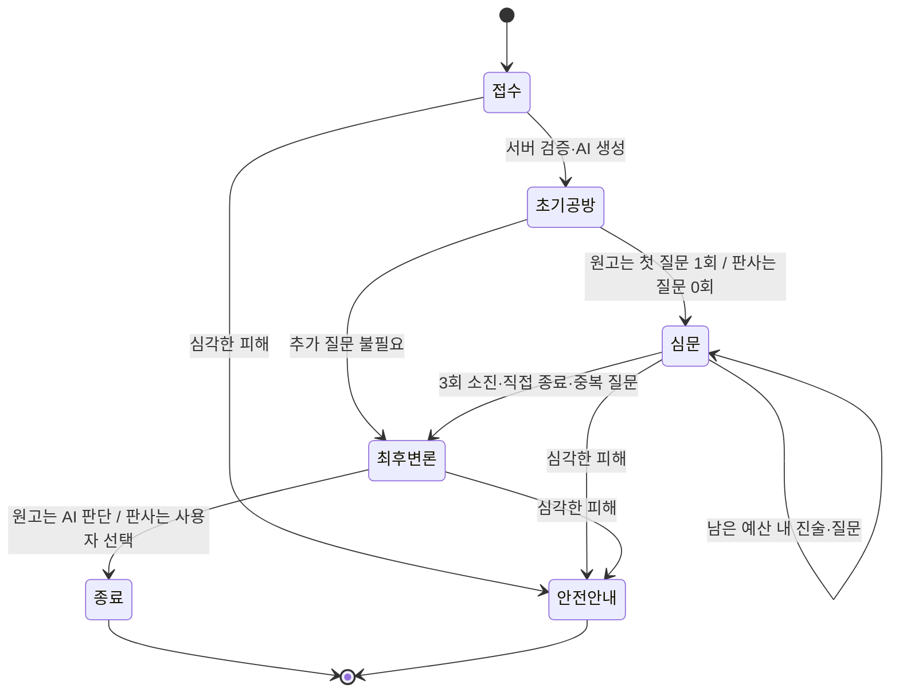

# AI 억울법정

**사소하지만 억울했던 순간, AI 법정에서 따져보세요!**

일상 속 작은 갈등을 세 가지 시선으로 살펴보는 참여형 AI 웹서비스입니다. KT is IT기획 지원 포트폴리오를 염두에 두고 사용자 여정, 대화 제어, 사실 관리, 예외 처리, 검증 근거를 함께 구성했습니다.

> 오락용 가상 재판이며 법적 효력이 없습니다.

## 구현 범위와 검증 상태

- 원고 모드: 자유 사연 접수 → AI 변호사·검사 공방 → 최대 3회 심문 → 최후 진술 또는 생략 → AI 판결문.
- 판사 모드: 준비된 사건 3개 → AI 양측 진술 → 당사자를 골라 최대 3회 질문 → 사용자가 판결 선택 → 선택한 결과로 판결문 정리.
- 서버 상태 머신, 심문 조기 종료, 이의 제기, 중복 요청 방지, 실패 시 상태 보존.
- 독립적인 SVG 판사·검사·변호사, 발언 강조, 모바일 대응, 사건 기록, 새로고침 후 복원.
- 서버 전용 Gemini SDK, 구조화 응답, Zod 및 역할·근거 ID 검증, 실패 시 1회 재시도.
- 원고 모드 사진 증거: 접수와 답변 때 재판당 최대 3장. 브라우저에서 축소·재인코딩해 위치정보(EXIF)를 지우고, Gemini가 사진마다 객관적 관찰 기록을 남깁니다. 서버는 사진 원본을 보관하지 않고 관찰 기록만 '사진 증거'로 표시하며, 진위·촬영 시점은 미확인으로 다룹니다.
- 보이스봇: 법정 대사를 역할별 목소리(높낮이·속도, 기기에 한국어 음성이 여러 개면 서로 다른 음성)로 읽고, 판사의 질문이나 당사자 답변이 끝나면 마이크를 자동으로 켜서 답을 받아 적습니다. 판결문도 읽어 줍니다. 음성 대화는 화면 상단에서 끌 수 있고 설정은 브라우저에 기억됩니다. 듣기를 시작하면 읽기를 멈춰 법정 음성이 다시 인식되지 않게 합니다.
- 음성 입력·출력은 브라우저 Web Speech API(인식·합성)를 사용해 별도 AI 비용이 없습니다. 지원 브라우저(Chrome, Edge, Safari)에서만 버튼이 보이며, 음성 인식은 브라우저의 음성 인식 서비스에서 처리됩니다. 목소리 품질은 기기에 설치된 음성에 따라 다릅니다.
- 판결문은 개인정보 확인 후 SVG 이미지로 다운로드할 수 있습니다. PNG 내보내기는 후속 범위입니다.

**현재 확인된 범위:** 프로덕션 빌드, TypeScript, ESLint, 서버/SDK 계약·음성 배정·저장소 테스트 56개(HTTP API 테스트는 메모리·Redis 저장소에서 각각 실행), 데스크톱·모바일 Chromium E2E 14개 통과. E2E의 음성 입력·출력은 가짜 음성 인식·합성 객체로 흐름만 검증했으며 실제 마이크 인식과 음성 품질은 확인하지 않았습니다. E2E는 명시적인 개발용 목업으로 진행했습니다. 실제 Gemini 모델의 대화 품질·지연·의미적 사실 정확성은 아직 검증하지 않았습니다.

## 빠른 실행

Node.js **22.12 이상**과 npm이 필요합니다. 개발·테스트 환경은 Node 24입니다.

```powershell
npm ci
```

`.env.example`을 프로젝트 루트의 `.env`로 복사하고 `GEMINI_API_KEY`(필수)와 필요한 값을 채웁니다. `.env`는 `.gitignore`로 제외되어 Git에 올라가지 않습니다. 키는 채팅이나 클라이언트 코드에 붙여 넣지 마세요.

```powershell
npm run dev
```

- 웹: <http://127.0.0.1:5173>
- API: <http://127.0.0.1:3001/api/health>
- `localhost:5173`으로도 접근할 수 있지만, 이어보기에는 접수했던 것과 같은 호스트를 사용해야 합니다.
- API 키가 없으면 재판 시작 시 설정 안내가 표시됩니다. 목업으로 자동 전환하지 않습니다.

**API 키 없이 화면과 진행만 확인할 때:**

```powershell
npm run dev:demo
```

개발용 목업임을 상단과 판결문에 표시합니다. `NODE_ENV=production`에서는 목업으로 서버를 시작할 수 없습니다.

## 환경변수

| 이름                    | 기본값 / 용도                                                                        |
| ----------------------- | ------------------------------------------------------------------------------------ |
| `GEMINI_API_KEY`        | 서버 전용 비밀 값. `.env`는 Git에서 제외                                             |
| `GEMINI_MODEL`          | `gemini-3.8-flash`, 모델 교체 가능                                                   |
| `GEMINI_FALLBACK_MODEL` | `gemini-3.5-flash-lite`. 첫 시도 실패 시 이 모델로 재시도. 비우면 같은 모델로 재시도 |
| `GEMINI_THINKING_LEVEL` | `low`. `default`·`minimal`·`medium`·`high`로 변경 가능                               |
| `AI_MODE`               | `gemini`. 개발 시에만 `mock` 허용                                                    |
| `PORT`                  | API 포트 `3001`                                                                      |
| `CLIENT_PORT`           | Vite 포트 `5173`                                                                     |
| `HOST`                  | 개발 `127.0.0.1`, 프로덕션 `0.0.0.0`                                                 |
| `APP_ORIGIN`            | 개발 `http://localhost:5173`. 프로덕션은 실제 HTTPS origin                           |
| `NODE_ENV`              | 개발 `development`. `npm start`가 `production` 지정                                  |
| `TRUST_PROXY_HOPS`      | 비움. 프록시 뒤에서 실행할 때 `1`~`5`. Vercel은 `1`                                  |
| `KV_REST_API_URL`       | 비움. Upstash Redis REST URL. Vercel의 Upstash 연동이 자동 주입                      |
| `KV_REST_API_TOKEN`     | 비움. Upstash Redis REST 토큰(비밀 값). URL과 함께 있을 때만 Redis 사용              |
| `UPSTASH_REDIS_REST_*`  | `_URL`·`_TOKEN`. Upstash 콘솔에서 직접 만든 경우 위 두 값 대신 사용 가능             |

Redis URL과 토큰이 **둘 다** 있으면 재판 기록·멱등성 결과·처리 잠금·요청 속도 제한을 Redis에 저장하고, 없으면 지금처럼 서버 메모리에 저장합니다. `npm run dev`, `dev:demo`, 테스트는 Redis 없이 동작합니다. 로컬 `.env`에 Redis 값을 넣으면 개발 서버도 그 Redis를 사용하므로, 운영 DB 값은 넣지 마세요.

`VITE_GEMINI_API_KEY`처럼 `VITE_` 접두어를 사용하면 안 됩니다. 브라우저는 동일 출처의 `/api`만 호출하며, 키나 모델 SDK를 포함하지 않습니다. 환경파일은 루트에 두고 명령도 루트에서 실행합니다.

## 기술 스택과 구조

React 19, TypeScript, Vite 7, Tailwind CSS 4, React Router, React Hooks, Lucide React, Node.js, Express 5, Zod 4, Google Gen AI SDK, Vitest 5, Playwright를 사용합니다. `package-lock.json`으로 설치 버전을 고정합니다. 검증된 설치 SDK는 `@google/genai@1.52.0`입니다.

```text
client/
  src/App.tsx          # 라우팅과 화면별 사용자 여정
  src/characters.tsx   # 독립 SVG 캐릭터 및 법정 배치
  src/api.ts           # 동일 출처 API, 타임아웃, 사용자 오류 안내
  src/style.css        # 디자인 토큰·반응형·접근성 스타일
server/
  src/app.ts           # HTTP API, 세션 소유권, 잠금, 멱등성, 오류 변환
  src/store.ts         # 저장소 인터페이스: 메모리 / Upstash Redis(REST)
  src/engine.ts        # 서버 권한의 재판 상태 머신
  src/ai.ts            # 역할별 프롬프트, JSON 스키마, Gemini 어댑터
  src/*.test.ts        # 상태·API·SDK 계약 테스트
shared/
  types.ts             # 화면과 서버가 공유하는 데이터 계약
  cases.ts             # 원고/피고 진술과 확정 사실이 분리된 사건 3개
api/index.js           # Vercel Function 엔트리(빌드된 Express 앱)
vercel.json            # Vercel 빌드·재작성·정적 보안 헤더
e2e/court.spec.ts       # 데스크톱·모바일 실제 브라우저 흐름
scripts/               # 프로덕션 스모크, 실제 AI 평가
docs/                  # 설계·검증 기록
```

## 사용자 흐름과 상태 제어



- 단계는 되돌릴 수 없습니다. 브라우저 뒤로 가기나 새로고침은 서버의 최신 단계로 복구합니다.
- 원고의 질문 수는 **AI 판사가 실제로 제시한 질문 수**입니다. 첫 질문이 1회이며, 세 번째 질문에 답한 뒤 종료합니다. 응답할 질문이 없으면 조기 종료합니다.
- 판사 모드의 질문 수는 **사용자가 제출한 질문 수**입니다. 세 번째 답변 직후 최후 변론으로 이동합니다.
- AI 응답에는 상태 전환 권한이 없습니다. 숫자·단계·확인된 사실은 클라이언트나 모델이 덮어쓸 수 없습니다.
- 질문의 정규화된 문구와 주제를 기록합니다. 원고 모드에서 같은 주제나 같은 문구가 제안되면 재질문하지 않고 종료합니다. 사용자가 판사일 때는 동일 문구 재질문을 거절합니다.
- 이의 제기는 발언을 선택하고 근거를 입력합니다. 해당 발언을 AI에 함께 전달하며, 재판당 1회·심문 예산 안에서 처리합니다. 원고 모드에서는 현재 질문에 대한 응답 기회를 대신합니다. 세 번째 질문 단계의 이의 제기 후에는 추가 질문 없이 종료합니다.
- 요청마다 `requestId`와 `version`을 검사합니다. 같은 요청은 같은 결과를 돌려주며, 세션별 처리 잠금으로 동시 호출을 막습니다. Redis를 쓰면 잠금과 멱등성 결과를 인스턴스끼리 공유합니다. 실패한 생성은 원본 세션에 반영하지 않습니다.

## AI 연동과 사실 관리

공식 [Google Gen AI JavaScript SDK](https://github.com/googleapis/js-genai), [모델 목록](https://ai.google.dev/gemini-api/docs/models), [구조화 출력 문서](https://ai.google.dev/gemini-api/docs/structured-output)를 확인하고 구성했습니다. 공식 목록의 안정 버전 `gemini-3.8-flash`를 기본값으로 선택했습니다(확인일: 2026-10-21). 사용 가능 여부와 할당량은 프로젝트 및 지역에 따라 달라질 수 있으므로 `.env`에서 변경할 수 있습니다.

한 번의 서버 호출이 여러 캐릭터의 짧은 대사를 JSON으로 생성합니다. 역할 규칙은 `systemInstruction`, 사용자 입력과 기록은 별도 JSON 자료로 전달합니다. 원고 모드에는 변호사·검사, 판사 모드 초기에는 원고·피고, 심문에는 선택한 당사자만 허용합니다. 질문을 일반 대사에 숨기지 않도록 별도 필드로 받고, 추가 물음표가 있는 대사는 검증 실패로 처리합니다.

확인된 사실, 원고 주장, 피고 주장, 다투는 쟁점, 미확인 정보, 모순, 증거 필드를 분리합니다. 원고 모드에서는 독립적으로 확인된 사실이 기본적으로 없으며, 사용자의 답변을 새로운 **원고 진술**로 추가합니다. 이전 진술은 지우지 않습니다. 모델이 참조한 근거 ID가 기록에 있는지 검증하며 모델은 새로운 확정 사실을 등록할 수 없습니다. 최종 판결에는 미확인 정보와 기록된 모순을 포함합니다.

판사 모드는 결과 필드를 사용자의 선택과 비교해 변경된 응답을 거부합니다. 서버도 최종 결과를 사용자 선택으로 다시 고정합니다. 문장 내용의 사실 왜곡·모순 탐지와 판결 이유의 의미적 충실성은 모델 성능에 의존하므로 실제 키로 추가 평가해야 합니다. 구조적 검증만으로 환각이나 프롬프트 인젝션을 완전히 방지한다고 주장하지 않습니다.

## API

| 경로                           | 설명                                                                           |
| ------------------------------ | ------------------------------------------------------------------------------ |
| `GET /api/health`              | 연결 상태, Gemini/목업 여부, 저장소(`memory`/`redis`). 비밀 값 미포함          |
| `GET /api/cases`               | 판사 모드 사건 3개                                                             |
| `POST /api/trials`             | `requestId`, `mode`, `title?`, `summary?`, `caseId?`로 접수·초기 공방          |
| `GET /api/trials/:id`          | 같은 브라우저 쿠키 소유자의 최신 재판 복구                                     |
| `POST /api/trials/:id/actions` | `requestId`, `version`, `type`, `input?`, `target?`, `messageId?`, `decision?` |

`type`은 `answer`, `objection`, `end`, `verdict`입니다. 오류는 `{ error: { code, message } }` 형식입니다. `400` 입력/응답 단계 오류, `403` 출처 제한, `404` 만료/다른 소유자, `409` 동시·오래된 요청/종료된 단계, `429` 속도 제한, `502` AI 실패, `503` AI 설정/인증 문제를 구분합니다.

## 기록 보관과 안전

- 재판 내용은 마지막 접근 후 2시간 동안만 복구됩니다. 메모리 저장소는 만료 자료를 다음 API 접근 시 정리하고 서버 재시작 시 모두 잃습니다. Redis 저장소는 키 만료 시간(TTL)으로 같은 2시간을 지키며, 사진 원본은 저장하지 않습니다.
- 브라우저 `sessionStorage`에는 **마지막 재판 ID만** 저장합니다. 원문·키·전체 재판을 로컬 저장하지 않습니다.
- 무작위 세션 ID와 HttpOnly·SameSite 쿠키로 소유권을 확인합니다. 프로덕션 쿠키는 Secure이며 HTTPS가 필요합니다.
- 모델에 사연이 전송되므로 이름·연락처 등 개인정보를 적지 않도록 접수 화면에서 안내합니다. 원문·API 키·SDK 오류 내용을 로그에 출력하지 않습니다.
- 심각한 피해는 서버 키워드 필터와 모델의 의미 분류로 확인하고, 대사를 표시하지 않은 채 별도 안전 화면으로 보냅니다. 키워드 필터에는 오탐·누락 가능성이 있습니다.
- 요청 크기, 입력 길이, 보관 세션 수, 요청 속도 제한과 보안 응답 헤더를 적용합니다. 인증·장기 보관·결제는 이번 범위에 없습니다.

## 빌드와 테스트

```powershell
npm run typecheck
npm run lint
npm test
npm run build
npm run smoke
npx playwright install chromium  # 최초 1회만 필요
npm run test:e2e
npm audit
npm run eval:ai  # 실제 Gemini 평가. .env에 GEMINI_API_KEY 필요, 무료 할당량 사용
```

`npm run eval:ai`는 [실제 AI 평가](docs/AI_EVALUATION.md)의 8개 항목을 실제 Gemini로 실행합니다. 질문 수·단계·판결 결과 같은 규칙은 자동으로 판정하고, 중립성처럼 문장을 읽어야 하는 기준은 휴리스틱 표시와 대화 원문을 `artifacts/ai-eval-*.json`에 남깁니다. `EVAL_ROUNDS`(기본 3), `EVAL_GAP_MS`(요청 간격, 기본 4000), `EVAL_ONLY=2,3`으로 조절합니다.

E2E는 별도 포트 **4173/3002**로 개발 목업 서버를 시작하고 종료합니다. Chrome 데스크톱과 iPhone 13 크기의 Chromium을 검증하며 실제 iOS Safari 검증은 아닙니다. 스크린샷은 `artifacts/`, 실패 기록은 `test-results/`에 생성됩니다. 세부 결과와 실제 AI 추가 평가 항목은 [테스트 기록](docs/TESTING.md)을 참조하세요.

프로덕션 로컬 실행:

```powershell
npm run build
npm start
```

웹과 API를 Express가 함께 제공합니다. 기본 포트는 `3001`입니다. 프로덕션의 세션 동작에는 HTTPS가 필요합니다. 로컬 HTTP에서 전체 체험을 하려면 `npm run dev`를 사용하세요.

## Vercel 배포 (무료 플랜)

Vercel은 요청마다 다른 함수 인스턴스가 처리할 수 있으므로, 재판 기록을 **Upstash Redis**(Vercel Marketplace 무료 플랜)에 저장합니다.

| 구성           | 내용                                                                                                    |
| -------------- | ------------------------------------------------------------------------------------------------------- |
| 화면           | `npm run build`의 `client/dist`를 Vercel CDN이 제공. 없는 경로는 `index.html`로 재작성(SPA)             |
| API            | `/api/*` → `api/index.js` 함수 하나가 Express 앱 전체를 처리. 최대 실행 60초                            |
| 보안 헤더      | API는 helmet, CDN 페이지는 `vercel.json`의 같은 헤더. 둘이 같은지 테스트로 검사                         |
| 재판·멱등성    | `court:trial:{id}`, `court:done:{owner}:{requestId}`. 2시간 TTL, 재판은 조회·진행 시 연장               |
| 처리 잠금      | `court:lock:{id}`를 `SET NX PX 75000`으로 획득, 토큰이 같을 때만 해제. 함수가 중단돼도 75초 뒤 자동 해제 |
| 세션 수 제한   | 만료 시각을 점수로 둔 정렬 집합으로 전체 1000개·소유자당 15개 유지                                      |
| 요청 속도 제한 | 분당 180회·쓰기 40회를 Redis 카운터로 모든 인스턴스가 공유                                              |

Redis 클라이언트는 Upstash REST API를 `fetch`로 직접 호출하므로 추가 패키지가 없습니다. Redis에 연결할 수 없으면 메모리로 바꾸지 않고 `500 SERVER_ERROR`를 반환합니다. 인스턴스마다 기록이 달라지는 것을 막기 위해서입니다.

### 배포 순서

1. 이 저장소를 GitHub에 올립니다.
2. Vercel 대시보드 → **Add New → Project**에서 저장소를 Import합니다. Framework Preset은 **Other**, Root Directory는 저장소 루트로 둡니다. 빌드 명령·출력 폴더는 `vercel.json`이 지정하므로 비워 둡니다.
3. 프로젝트 → **Storage → Create Database → Upstash for Redis**에서 무료 플랜을 고르고 프로젝트에 연결합니다. 환경은 Production(필요하면 Preview도)을 선택합니다. `KV_REST_API_URL`, `KV_REST_API_TOKEN`이 자동으로 추가됩니다. 지역은 함수 지역과 가깝게 고릅니다. 함수 기본 지역은 미국 동부(`iad1`)이고, **Settings → Functions → Function Region**에서 서울(`icn1`)로 바꿀 수 있습니다.
4. **Settings → Environment Variables**(Production)에 추가합니다.
   - `GEMINI_API_KEY`: Gemini API 키. Sensitive로 저장
   - `APP_ORIGIN`: `https://<프로젝트>.vercel.app`처럼 실제 주소. 끝에 `/` 없이 정확히 입력
   - `TRUST_PROXY_HOPS`: `1`. 사용자별 요청 속도 제한에 필요
   - 선택: `GEMINI_MODEL`, `GEMINI_FALLBACK_MODEL`, `GEMINI_THINKING_LEVEL`
   - 넣지 않을 값: `NODE_ENV`(빌드에 필요한 개발 의존성 설치가 빠짐), `AI_MODE=mock`(프로덕션에서는 서버가 시작되지 않음), `PORT`, `HOST`
5. **Deployments**에서 최신 배포를 **Redeploy**합니다. 환경변수는 새 배포부터 적용됩니다.

### 배포 후 확인

1. `https://<도메인>/api/health`가 `{"ok":true,"aiMode":"gemini","configured":true,"store":"redis"}`인지 확인합니다. `store`가 `memory`면 Redis 연결(3단계)을 다시 확인합니다.
2. 원고 모드로 접수 → 답변 → 새로고침 후 복원 → 판결까지 진행합니다. 사진 증거 3장도 한 번 첨부해 봅니다.
3. Upstash 콘솔의 Data Browser에서 `court:trial:*` 키와 약 7200초 TTL을 확인합니다.
4. 브라우저 개발자 도구에서 첫 페이지 응답에 `Content-Security-Policy` 헤더가 있는지 확인합니다.
5. Vercel **Logs**에서 `[ai] ... failed` 경고나 500 오류가 없는지 확인합니다.

### 제한과 주의

- **요청 크기:** Vercel 함수 요청 본문은 4.5MB까지입니다. 사진은 장당 base64 1,400,000자로 줄여 올리므로 3장과 사연 5,000자를 합쳐도 약 4.22MB로 제한 안에 들어갑니다.
- **Preview 배포:** 주소가 `APP_ORIGIN`과 달라 쓰기 요청이 `403 ORIGIN`으로 거절됩니다. Preview에서 시험하려면 Preview 환경에 그 주소의 `APP_ORIGIN`을 따로 지정합니다. 커스텀 도메인을 연결하면 `APP_ORIGIN`을 바꾸고 다시 배포합니다.
- **무료 한도:** 재판 1건(접수·심문 3회·판결)에 Redis 명령이 약 80~120개 쓰입니다(측정값: 접수 19, 진행 1회 17, 조회 8). 월 명령 한도는 Upstash 대시보드에서 확인하세요. Gemini 무료 등급 한도에 걸리면 `429 AI_BUSY` 안내가 표시됩니다.
- Redis 동작은 실제 Redis 없이 Upstash 명령을 흉내 내는 테스트용 클라이언트로 검증했습니다(여러 인스턴스 공유, TTL, 잠금, 세션 수, 속도 제한). 실제 Upstash에서는 위 확인 절차로 점검합니다.

## 남은 검증과 개선

- **P0 남은 확인:** 실제 Gemini 키로 두 모드를 끝까지 실행하며 내용 반영, 중립성, 의미 중복 질문, 모순·민감 사례, 응답 품질과 지연을 평가해야 합니다.
- **P1 미구현:** PNG 내보내기. 현재 내보내기는 SVG입니다. 실제 Gemini로 사진 관찰 기록의 정확성과 개인정보 배제를 평가해야 합니다.
- **확장:** 재판 목록·삭제, 익명 공유 링크, 실제 Safari 및 보조공학 평가.

설계 결정과 처음의 작업 계획은 [설계 문서](docs/ARCHITECTURE.md)를 참조하세요.
