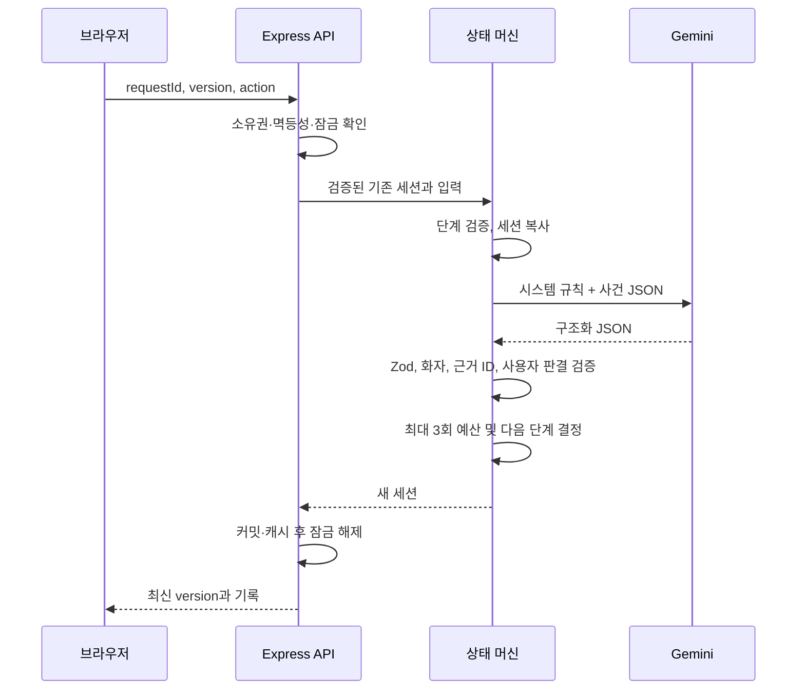

# 설계와 구현 계획

## 초기 조사

작업 디렉터리 `D:\project3`는 비어 있었습니다. 기존 앱이나 유지해야 할 파일이 없어 npm workspaces로 `client`, `server`, `shared`를 구성했습니다. 사용자가 지정한 React/Vite·Express 구조 및 로컬 실행·배포 문서 요구를 우선하여 호스팅 서비스 전용 런타임으로 변경하지 않았습니다.

## 개발 순서

1. 공통 타입, 사건 원장 3개, 단계와 API 계약 설계.
2. 홈페이지, 역할 선택, 접수, 심문, 최후 변론, 판결문 화면 연결.
3. 동일한 SVG 얼굴·선 굵기·색감으로 판사·검사·변호사 구성.
4. 서버 상태 머신과 개발용 목업으로 양 모드 흐름 검증.
5. 서버 측 Gemini SDK, 역할별 시스템 프롬프트, Zod·근거 검증 연결.
6. 상태·API·SDK 계약 테스트 및 데스크톱·모바일 브라우저 검증.
7. 화면 검토, 발견한 문제 수정, 실행·배포·한계 문서화.

코드 구현과 목업 기반 통합 검증을 수행했습니다. 실제 Gemini 모델을 이용한 플레이 검증은 API 키가 없어 남아 있습니다.

## 주요 결정

| 결정                                 | 이유                                                                                             |
| ------------------------------------ | ------------------------------------------------------------------------------------------------ |
| 모델 1개가 여러 인물을 생성          | 여러 에이전트의 조율·비용을 늘리지 않고, 한 턴의 역할 수와 길이를 통제                           |
| 서버만 상태를 소유                   | 브라우저 조작과 모델 출력으로 질문 횟수·단계가 변경되지 않도록 함                                |
| AI 응답을 받은 뒤 상태 반영          | 실패/잘못된 JSON 시 질문 소진이나 진술 중복이 발생하지 않도록 함                                 |
| 세션별 잠금 + 버전 + 요청 ID         | 연속 클릭·동시 탭·응답 유실 후 재시도를 서로 다른 계층에서 처리                                  |
| 원고 진술과 확정 사실 분리           | 상대방의 의도와 일방적 주장을 사실로 둔갑시키지 않도록 함                                        |
| 원고 심문에서 문구/주제 중복 시 종료 | 불필요한 재시도·무한 대화보다 명시적인 종료를 보장                                               |
| 판사 모드 결과 완전 고정             | 사용자의 핵심 역할인 판결권을 AI가 침범하지 않도록 함                                            |
| 2시간의 서버 메모리 세션             | 작은 단일 인스턴스 포트폴리오에서 보관 범위와 개인정보 잔존 최소화. 수평 확장은 별도 저장소 필요 |
| SVG 직접 제작                        | 실사 없이 통일된 그림체를 유지하며 표정·복장을 코드로 관리                                       |
| 외부 폰트/CDN 미사용                 | 외부 연결 없이 화면 렌더링 가능. 한국어 시스템 글꼴로 폴백                                       |

## 요청 처리

AI 요청은 최대 25초 제한으로 2회 시도합니다. 인증 실패는 즉시 중단합니다. 클라이언트는 60초 동안 기다리며 응답을 받지 못하면 입력을 유지합니다. 진행 중 버튼과 동기식 잠금으로 같은 렌더 프레임의 연속 클릭까지 막습니다.

## 의미적 검증의 한계

고정 사실은 AI가 추가할 수 없고 존재하지 않는 근거 ID는 거절합니다. 그러나 모델이 올바른 ID를 인용하면서 문장 내용을 왜곡할 가능성까지 프로그램으로 완전히 증명할 수는 없습니다. 모순 탐지, 심각한 피해 분류, 이미 답한 질문의 의미적 인식도 실제 모델 평가가 필요합니다. API 키 없는 상태에서 이 항목을 완료로 판단하지 않습니다.

## 실제 배포 전 확장 지점

단일 서버의 `Map`을 소유권·버전 조건을 지원하는 저장소로 옮겨야 다중 인스턴스와 서버리스 환경에서 같은 보장을 유지할 수 있습니다. 이때 동시 처리 잠금과 멱등성 캐시도 저장소 트랜잭션으로 함께 옮겨야 합니다. 인증과 사용자별 삭제, 동의·보관 정책은 실제 운영 범위에 맞게 결정해야 합니다.
